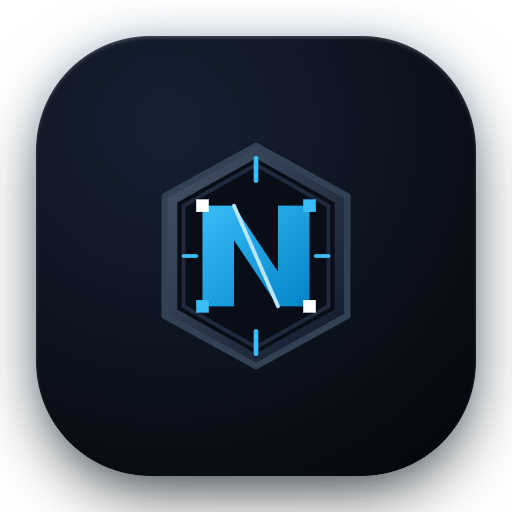

<div align="center">
  
  <h1>NexAlloyNext-Patches</h1>
  <p><strong>Modular runtime bytecode patch bundles (.nxb) for NexAlloyNext and LSPosed.</strong></p>
  <p>
    <a href="https://github.com/a092devs/NexAlloyNext-Patches/releases"></a>
    
    
    
    
    <a href="LICENSE"></a>
  </p>
  <p>
    <a href="#-getting-started">🚀 Getting Started</a> •
    <a href="#-core-architecture--design">⚡ Architecture</a> •
    <a href="#-bundle-structure--contract">📦 Bundle Contract</a> •
    <a href="#-curated-patch-bundles--supported-applications">🧩 Supported Apps</a> •
    <a href="#-building-from-source">🛠️ Building</a>
  </p>
</div>

---

## 📖 Overview

**NexAlloyNext-Patches** provides modular runtime bytecode patches packaged into `.nxb` bundles for the [NexAlloyNext](https://github.com/a092devs/NexAlloyNext) root + LSPosed manager ecosystem.

Unlike traditional patching tools that decompile, modify, re-sign, and reinstall target APKs, **NexAlloy patches execute entirely in-memory at process startup**:

- 🔒 **Zero APK Tampering:** Target applications remain official, unaltered on disk, and preserve their authentic Play Store signatures and Play Protect integrity.
- ⚡ **Dynamic DexKit Interception:** Obfuscated classes, methods, and fields are resolved at process startup via bytecode pattern analysis and string fingerprinting.
- 🛡️ **Fail-Safe Isolation:** Hooks execute with comprehensive `runCatching` safeguards, ensuring target apps remain stable and functional even if non-critical symbols change across updates.
- 📦 **Containerized `.nxb` Bundles:** Patches are packaged into signed `.nxb` APK containers loaded directly into process memory without requiring APK installation.

> [!IMPORTANT]
> - **Runtime-Only Architecture:** Patches run purely in-memory via LSPosed (API 101). Target APK files are never modified, re-signed, or repackaged.
> - **Trusted Sources:** Bytecode executes within target application processes. Always install patch bundles from trusted developers and verified repositories.
> - **Integrity Guarantee:** Banking, payment, and security-critical applications are deliberately excluded from patch targets.

---

## ⚡ Core Architecture & Design

### 1. 🔍 Feature Detection Over Hardcoded Offsets
Patches locate target bytecode dynamically using DexKit pattern analysis, opcodes, and string references rather than fragile hardcoded class names or method offsets. This ensures robust resilience across minor and major application updates.

### 2. 🛡️ Fault-Tolerant Hook Lifecycle
Every hook registration is isolated within safe runtime execution boundaries. If an obfuscated symbol cannot be resolved due to an unexpected upstream UI rewrite, only the specific affected feature degrades gracefully — preventing application crashes.

### 3. 🎯 Truthful Application Targets
Bundle entries explicitly declare verified application version ranges (`AppPatchInfo.targets`). NexAlloyNext uses these declarations to drive honest compatibility badges and update indicators in the manager UI.

---

## 📦 Bundle Structure & Contract

A `.nxb` file is a signed APK container loaded directly into process memory by NexAlloyNext. The manager inspects the following `meta-data` entries from the bundle's `AndroidManifest.xml`:

| `meta-data` Key | Value Type | Description |
|---|---|---|
| `nexalloy.bundle.entry` | FQCN Class | Class implementing `io.github.nexalloy.PatchBundle` (entry point) |
| `nexalloy.bundle.apiVersion` | Integer | Patcher API version the bundle was compiled against (e.g. `1`) |
| `nexalloy.bundle.author` | String | Bundle author displayed in the NexAlloyNext manager |
| `nexalloy.bundle.description` | `@string` | String resource describing the bundle's capabilities |
| `nexalloy.bundle.compatibilitySeries` | String | Compatible manager compatibility series (e.g. `3.5`) |
| `nexalloy.bundle.minManagerVersion` | String | Minimum required manager version (e.g. `3.5.0`) |
| `nexalloy.bundle.maxManagerVersion` | String | Maximum supported manager version (or empty for forward compatibility) |

### Manifest Contract & Resource Isolation
- **Entry Point:** The entry class implements `io.github.nexalloy.PatchBundle`, returning the list of supported applications (`AppPatchInfo`) and their verified versions.
- **Resource Partitioning:** Custom UI resources are assigned dedicated package IDs (`0x02`–`0x7e`, never the application ID `0x7f`) to prevent resource collision when multiple bundles hook into the same process.

---

## 🚀 Getting Started

1. **📥 Install NexAlloyNext:** Download and install the manager from [NexAlloyNext Releases](https://github.com/a092devs/NexAlloyNext/releases).
2. **🛡️ Configure LSPosed:** Enable the **NexAlloyNext** module in LSPosed and add your desired target applications to its scope.
3. **📦 Install Patch Bundles:** Open NexAlloyNext → **Patches** tab. The official companion repository (`a092devs/NexAlloyNext-Patches`) is pre-configured; tap **Install** on `NexFusion Patches`.
4. **⚙️ Toggle Desired Patches:** Open the **Home** tab, tap any target application card, and enable your preferred runtime hooks.
5. **🔄 Apply & Restart:** Tap **Force Stop** or use the 1-tap **App Info** shortcut to restart the target application and let LSPosed attach the updated bytecode hooks.

---

## 🧩 Curated Patch Bundles & Supported Applications

### Curated Distributions

- **`nexalloy`:** Streaming core patches for YouTube, YouTube Music, and Google Photos cloud storage spoofing.
- **`nexfusion` (`NexFusion Patches`):** Unified community runtime distribution covering all **17 supported application targets** in a single `.nxb` package.

---

### Supported Applications Matrix

#### 🎥 Video, Audio & Streaming
| Application | Package Identifier | Key Patch Capabilities |
|---|---|---|
| **YouTube** | `com.google.android.youtube` | Remove video and feed ads, SponsorBlock integration, background playback, link sanitization, custom playback speeds & quality selector, swipe volume/brightness controls, layout component filtering, DeArrow title/thumbnail replacement, Litho node bypass, Shorts resuming, Ambient mode, Miniplayer, PiP seek buttons, disable playlist autoplay, channel search fingerprint fix, guarded navigation bar hook against abstract methods. |
| **YouTube Music** | `com.google.android.apps.youtube.music` | Background audio playback, audio ad removal, exclusive audio stream playback, hide upgrade buttons, suppress promotional banners. |
| **Spotify** | `com.spotify.music` | Audio ad muting, hide ad views & video interstitial banners, hide Premium navigation tab, Dynamic Material You theme, custom rounded UI corners, tracking link cleaner. |

#### 💬 Social Networks & Messaging
| Application | Package Identifier | Key Patch Capabilities |
|---|---|---|
| **Telegram** | `org.telegram.messenger` | Remove channel sponsored messages, search sponsored accounts, and video ads; hide Story bar, avatar story rings, and Post Story button; hide proxy sponsored channels; keep deleted messages locally; exact unrounded member/subscriber/view counts; faster file downloads (512 KB chunks with 8 concurrent connections); block in-app APK update prompts; disable analytics, crash logs, and call diagnostics; open links in default system browser; strip link tracking parameters (`utm_*`, etc.); auto-reveal spoiler text/media; mask phone number; disable double-tap reaction trigger; auto-close keyboard on scroll; hide Premium, gifts, and Stars upsell prompts; hide greeting stickers; hide floating translate bar; filter blocked users in groups; play voice/video notes one at a time; volume keys only change volume without unmuting video; disable pull-to-archive; disable pull-up to next channel; disable chat swipe actions; disable draft link previews; render system fonts instead of bundled Roboto; pure black AMOLED (#000000) dark theme. Verified targets: 13.1.1 (Play Store), 13.1.0, 12.10.6. |
| **Telegram (Web)** | `org.telegram.messenger.web` | Identical full-suite runtime patches as official Telegram for web-distributed standalone builds. Verified targets: 13.1.1, 13.1.0, 12.10.6. |
| **Instagram** | `com.instagram.android` | Media downloader (posts, multi-photo carousels, Reels, Stories, Highlights, profile pictures) with custom save directory, per-username subfolders, and timestamp naming; sponsored post, Reels, and Story ad removal; anonymous Story and Live stream viewing; tracking link sanitizer; ghost mode. Verified targets: 453.0.0.38.87, 452.0.0.47.108, 451.0.0.44.109. |
| **Facebook** | `com.facebook.katana` | Media downloader for photos, videos, Reels, and Stories with DASH stream and audio extraction; hide sponsored posts, Reels, and Stories; screenshot restriction bypass; telemetry blocking. Verified targets: 584.0.0.46.108, 583.0.0.47.69, 582.0.0.41.97. |
| **X (Twitter)** | `com.twitter.android` | Promoted post and ad removal; video and GIF download unlock; bypass Compose sensitive media blur interstitials without tap-to-reveal; outdated-app warning and forced in-app update block; telemetry and analytics blackholing; Premium upsell removal; tracking link sanitizer. Verified targets: 11.45.0-release.0, 11.44.0-release.0, 11.43.0-release.0. |
| **Reddit** | `com.reddit.frontpage` | Feed and comment ad removal, start as guest mode, sanitize sharing URLs, suppress screenshot banner, custom feed sorting, Redgifs audio unmuting. Verified targets: 2026.43.0, 2026.42.0, 2026.41.0. |
| **Discord** | `com.discord` | Suppress crash telemetry, analytics, touch logging, install attribution, and advertising identifiers; native phone font support. Verified targets: 286.0 through 292.0. |
| **LinkedIn** | `com.linkedin.android` | 1-tap media downloader for photos, multi-image carousels, and progressive MP4 videos with download overlay button; sanitize copy and share links; bypass `safety/go` interstitial redirects directly; hide suggested posts (`Suggested`, `Disarankan`); hide promoted jobs (`Promoted`, `Dipromosikan`); hide Premium upsell banners in navigation panel and SDUI feeds; feed filters (celebrations, job cards, reposts, videos, reaction counts, new posts pill); Material You dynamic wallpaper palette (Android 12+); suppress tracking telemetry. Verified targets: 4.1.1266, 4.1.1265, 4.1.1264. |

#### 🛠️ System, Productivity & Utilities
| Application | Package Identifier | Key Patch Capabilities |
|---|---|---|
| **Google Photos** | `com.google.android.apps.photos` | Device spoofing for unlimited original-quality Google Photos cloud storage backup, DCIM folder backup control. |
| **Gboard** | `com.google.android.inputmethod.latin` | Rounded keycap styling and expressive UI borders; Google Sans Flex typography & GM3 Expressive styling; proactive post-correction undo controls; Quick & Magic Emoji (Emojify); expanded AI writing tools (proofread across apps, streaming UI, inline replace button); spellchecker chips UI; scan text OCR; screenshot chips & clipboard paste suggestions; spacebar cursor trackpad gesture control. |
| **Gmail** | `com.google.android.gm` | Suppress sponsored promotional and advertising cards in personal inboxes. |
| **Google App (Discover)** | `com.google.android.googlequicksearchbox` | Filter sponsored cards, shopping ads, and promotional content in the Discover feed. |
| **MiXplorer** | `com.mixplorer` | Fix scoped-storage file sharing by masking unreadable `_data` paths on Android 11+. |
| **Proton VPN** | `ch.protonvpn.android` | Suppress upgrade prompts, unlock NetShield UI toggles, disable telemetry and observability background workers. |

---

## 🛠️ Building from Source

### Prerequisites
- JDK 21 (Temurin or OpenJDK) or JDK 25 LTS
- Android SDK with API 37 platform tools (configured via `ANDROID_HOME` or `local.properties`)

### Build Commands
```bash
# Clone the repository
git clone https://github.com/a092devs/NexAlloyNext-Patches.git
cd NexAlloyNext-Patches

# Run unit tests across all bundles
./gradlew testDebugUnitTest

# Assemble all .nxb release bundles
./gradlew assembleBundle

# Assemble a specific bundle (e.g. NexFusion)
./gradlew :bundles:nexfusion:assembleBundle
```

The compiled bundles will be generated in `bundles/<bundle-name>/build/outputs/bundle/*.nxb`.

---

## 🌐 Discovery & Release Pipeline

NexAlloyNext discovers bundles through **patch sources**. A source can be configured as:
- **GitHub Release Source:** A repository (`owner/repo`) whose latest release provides compiled `*.nxb` assets.
- **Direct Feed Source:** A JSON endpoint declaring bundle versions, download URLs, and metadata:
  ```json
  {
    "version": "3.5.5",
    "download_url": "https://github.com/a092devs/NexAlloyNext-Patches/releases/download/v3.5.5/nexfusion-3.5.5.nxb",
    "description": "Unified community runtime patch bundle"
  }
  ```

Automated releases are published via [`.github/workflows/release.yml`](.github/workflows/release.yml) upon verified version declarations in `CHANGELOG.md`.

---

## 🤝 Contributing

Contributions, bug reports, and pull requests are welcome!
- Ensure all unit tests pass prior to opening pull requests: `./gradlew testDebugUnitTest`
- All contributions must adhere to the runtime-only architecture (in-memory execution via LSPosed API 101, zero APK modification).
- Ensure target application stability by wrapping non-essential hooks in `runCatching` safeguards.

---

## 📜 Credits & Acknowledgments

NexAlloyNext-Patches is developed and maintained by **a092devs**. We gratefully acknowledge the open-source projects, reverse engineers, and library authors whose research and tools empower our patch ecosystem:

| Project | Contribution |
|---|---|
| **[LSPosed](https://github.com/LSPosed/LSPosed)** | Core ART runtime hooking framework and official `libxposed` (API 101) |
| **[DexKit](https://luckypray.org/DexKit/en/)** | High-performance Dex bytecode pattern matching and opcode resolution |
| **[Morphe](https://morphe.software)** | Bytecode runtime hook patterns, fingerprint specifications, and shared utilities |
| **[ReVanced](https://revanced.app)** | Reverse engineering research, feature specifications, and community contributions |
| **[SysAdminDoc](https://github.com/SysAdminDoc)** | Stealth, ad-blocking, and media extraction hook specifications |
| **[Piko](https://github.com/crimera/piko)** | Runtime hook logic and downloader patterns |
| **[VenusIsJaded](https://github.com/VenusIsJaded/Venus-Patches)** | Privacy target tables and font styling |
| **[heyymichii](https://github.com/heyymichii/michii-patches)** | Share-link cleaning, direct navigation, and tracking removal |
| **[ak800i](https://github.com/ak800i/mixplorer-patches-for-morphe)** | Scoped-storage file sharing fix for Android 11+ |
| **[jkennethcarino](https://github.com/jkennethcarino/adobo)** | Screenshot-banner suppression, link sanitization, and UI hooks |
| **[gnadgnaoh](https://github.com/gnadgnaoh/NexAlloy-XES)** | Inbox promotion and Discover feed ad filtering |

---

## ⚖️ License

NexAlloyNext-Patches is open-source software developed by **a092devs** and licensed under the **GNU General Public License v3.0** — see [LICENSE](LICENSE). Third-party libraries, ported feature specifications, and upstream dependencies retain their respective licenses and attribution.
